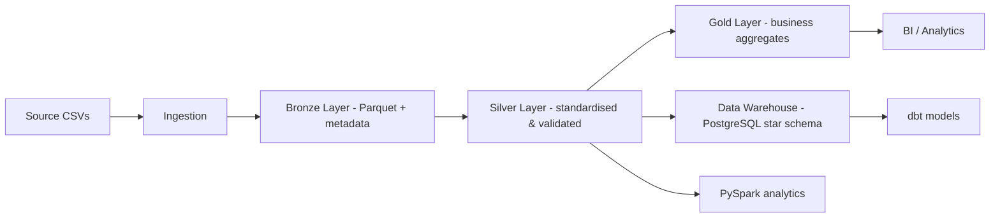

# Olist Marketplace Data Engineering Platform

An independent, production-oriented Data Engineering platform built on the
[Brazilian E-Commerce Public Dataset by Olist](https://www.kaggle.com/datasets/olistbr/brazilian-ecommerce).

This repository is a standalone project. It is not derived from any other repository's
implementation or history.

## Business Context

An e-commerce marketplace generates fragmented operational data across orders,
customers, products, sellers, payments, and reviews. Raw operational data alone does
not provide reliable business intelligence. This platform integrates, validates,
standardises, and models that data into trustworthy analytical datasets.

## Architecture



### Medallion Layers

- **Bronze**: raw source data preserved as Parquet with ingestion metadata and
  source hashes. No transformation beyond reading.
- **Silver**: standardised types, deduplicated keys, validated referential integrity.
- **Gold**: business-ready aggregations answering marketplace questions.

### Data Warehouse

Star schema in PostgreSQL (`dw` schema):

- Dimensions: `dim_date`, `dim_customer`, `dim_seller`, `dim_product`
- Facts: `fact_order_items` (grain: one row per order item), `fact_orders` (grain: one row per order)

## Tech Stack

- Python 3.11, pandas, pyarrow
- PostgreSQL 17 (Docker)
- PySpark 3.5
- dbt (Postgres adapter)
- Docker Compose
- pytest, ruff
- GitHub Actions

## Quick Start

```bash
# 1. Clone
git clone https://github.com/Raf-Hs/olist-marketplace-data-engineering-platform.git
cd olist-marketplace-data-engineering-platform

# 2. Python env
python3.11 -m venv .venv
source .venv/bin/activate
pip install -r requirements.txt

# 3. Environment
cp .env.example .env
# edit .env (port 5434 by default to avoid conflicts)

# 4. Infrastructure
docker compose up -d

# 5. Run pipeline
python -m src.orchestration.pipeline

# 6. Spark analytics
python src/spark/transformations.py  # or run_spark.py

# 7. dbt
cd dbt && dbt run
```

## Project Structure

See `docs/` for architecture, data dictionary, data quality, and more.

## Business Questions Answered

- Evolution of marketplace revenue (monthly)
- Top product categories by revenue
- Top sellers by sales volume
- Delivery time and late delivery rate
- Payment method distribution
- Relationship between delivery performance and review scores
- Cancellation rate

## Testing

```bash
pytest -q
```

## Limitations

- Azure components are documented as architecture only (no paid resources created).
- Airflow DAG is provided as reference; local execution uses the Python pipeline.
- Dataset is loaded from local CSVs (Kaggle download required for fresh data).
