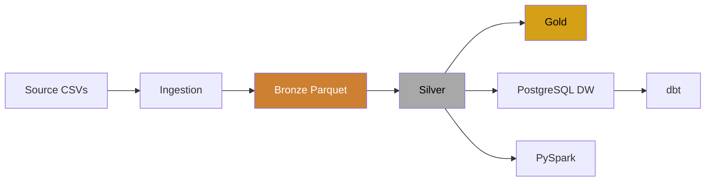
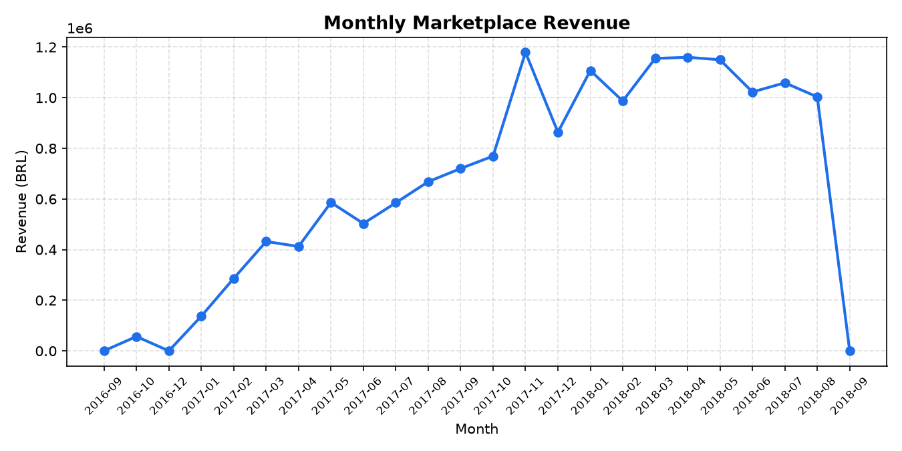
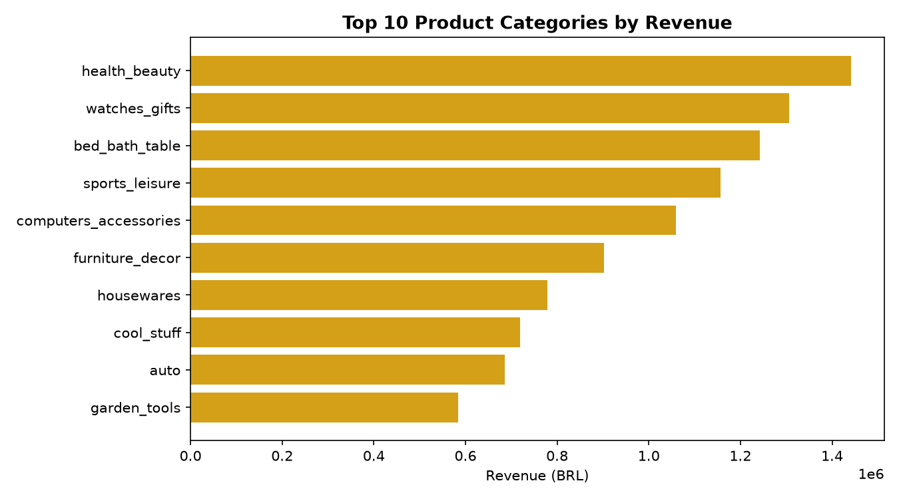
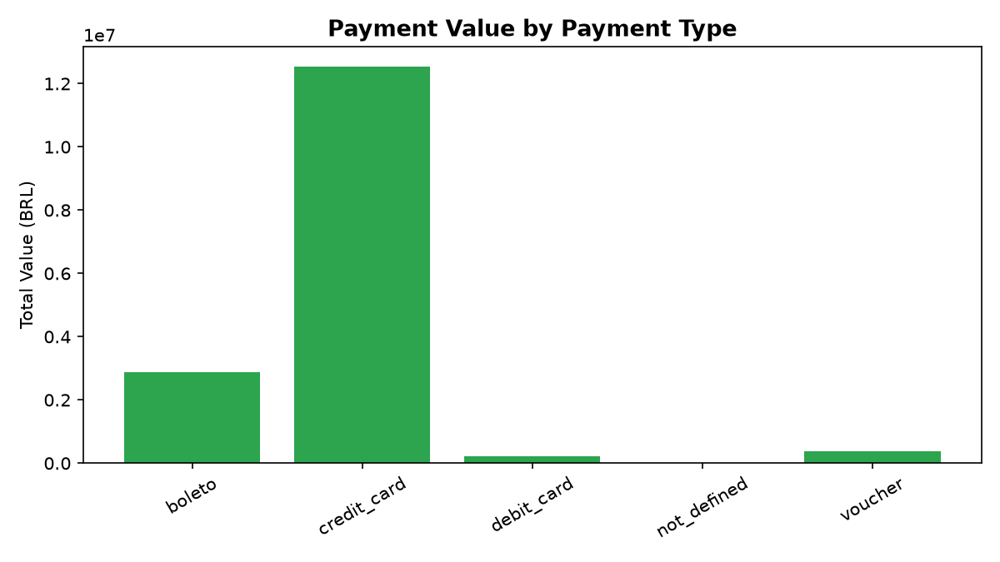
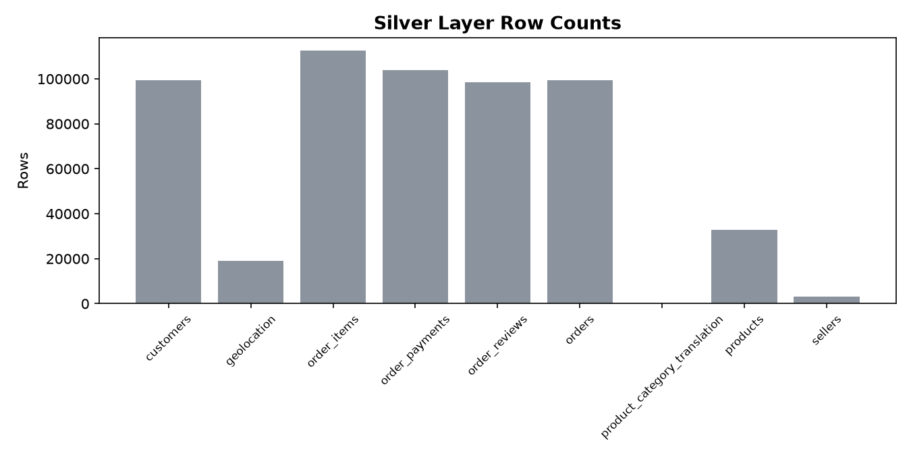

# Olist Marketplace Data Engineering Platform


A batch data engineering platform on the
[Brazilian E-Commerce Public Dataset by Olist](https://www.kaggle.com/datasets/olistbr/brazilian-ecommerce).
It integrates fragmented marketplace data into a Medallion lake (Bronze/Silver/Gold),
a PostgreSQL star-schema warehouse, PySpark analytics, and dbt models.

## Business Problem

Marketplace data is split across orders, customers, products, sellers, payments,
reviews, and geolocation. Raw CSVs alone do not answer business questions such as
revenue evolution, top categories/sellers, delivery performance, payment behaviour,
or the link between delivery time and review scores.

## Solution at a Glance

- **Ingest** 9 source CSVs with schema validation and SHA-256 provenance.
- **Standardise** into Silver with deduplication and type normalisation.
- **Validate** with 13 automated data quality checks.
- **Aggregate** into Gold business datasets.
- **Model** a 6-table star schema in PostgreSQL.
- **Analyse** with PySpark and dbt.

## Architecture



See [docs/architecture.md](docs/architecture.md) for details.

## Medallion Layers

| Layer | Purpose | Format |
|---|---|---|
| Bronze | Raw preservation + metadata (hash, row count, timestamp) | Parquet |
| Silver | Standardised types, deduplicated keys, validated integrity | Parquet |
| Gold | Business-ready aggregations | Parquet |

## Key Verified Metrics

| Metric | Value |
|---|---|
| Source tables ingested | 9 |
| Source rows | 1,550,922 |
| Silver rows | 568,960 |
| Gold datasets (pandas) | 6 |
| Gold datasets (Spark) | 4 |
| Warehouse tables | 6 (4 dims + 2 facts) |
| Automated quality checks | 13 (passing with local data) |
| Tests | 11 (10 pass without PostgreSQL) |

Warehouse row counts are audited in
[docs/audits/DATA_WAREHOUSE_AUDIT.md](docs/audits/DATA_WAREHOUSE_AUDIT.md) and
were not re-run in this environment (PostgreSQL unavailable).

## Tech Stack

- Python 3.11+ (targets 3.11; tested here on 3.12)
- pandas, pyarrow, SQLAlchemy, psycopg2
- PostgreSQL 17 (Docker)
- PySpark 3.5
- dbt (Postgres adapter)
- Docker Compose
- pytest, ruff
- GitHub Actions

## Repository Structure

```text
olist-marketplace-data-engineering-platform/
├── src/
│   ├── ingestion/        # schemas + CSV ingestion
│   ├── transformations/  # silver + gold
│   ├── quality/          # data quality checks
│   ├── warehouse/        # star-schema loader
│   ├── spark/            # PySpark analytics
│   ├── orchestration/    # end-to-end pipeline
│   ├── config/           # settings + paths
│   └── utils/            # logging
├── tests/                # unit, data quality, integration
├── docs/                 # documentation + assets
├── dbt/                  # dbt project
├── airflow/dags/         # reference DAG
├── infra/postgres/init/  # DDL
├── scripts/              # convenience runners
└── .github/workflows/    # CI
```

## Documentation

See [docs/README.md](docs/README.md) for the full index. Highlights:

- [Architecture](docs/architecture.md)
- [Data Model](docs/data_model.md) / [Data Dictionary](docs/data_dictionary.md)
- [Data Quality](docs/data_quality.md)
- [Pipeline / Execution](docs/execution.md)
- [Testing](docs/testing.md)
- [Operations](docs/operations.md)
- [Technical Decisions](docs/technical_decisions.md)
- [Implementation Inventory](docs/implementation_inventory.md)
- [Limitations](docs/limitations.md)

## Quick Start

```bash
# 1. Clone
git clone https://github.com/Raf-Hs/olist-marketplace-data-engineering-platform.git
cd olist-marketplace-data-engineering-platform

# 2. Python env
python3.11 -m venv .venv
source .venv/bin/activate
pip install -r requirements.txt

# 3. Environment
cp .env.example .env
# edit .env (port 5434 by default)

# 4. Infrastructure
docker compose up -d

# 5. Run pipeline (Bronze -> Silver -> Quality -> Gold)
python -m src.orchestration.pipeline

# 6. Warehouse (separate step)
python -c "import sys; sys.path.insert(0,'.'); from src.warehouse.load import load_warehouse; load_warehouse()"

# 7. Spark analytics (optional, requires Java 17)
python -c "import sys; sys.path.insert(0,'.'); from src.spark.transformations import run_spark_analytics; print(run_spark_analytics())"

# 8. dbt (optional)
cd dbt && dbt run && dbt test
```

## Business Questions Answered

- Evolution of marketplace revenue (monthly)
- Top product categories by revenue
- Top sellers by sales volume
- Delivery time and late delivery rate
- Payment method distribution
- Relationship between delivery performance and review scores
- Cancellation rate

## Results (verified from local outputs)









## Testing

```bash
pytest -q
```

See [docs/testing.md](docs/testing.md).

## Limitations

- Azure components are documented as architecture only (no paid resources created).
- Airflow DAG is provided as reference; local execution uses the Python pipeline.
- Dataset is loaded from local CSVs (Kaggle download required for fresh data).
- Spark has no committed entry point (`run_spark.py` is missing).
- Warehouse load is a separate manual step.

See [docs/limitations.md](docs/limitations.md) for the full list.

## License

No license file is currently provided in this repository.
