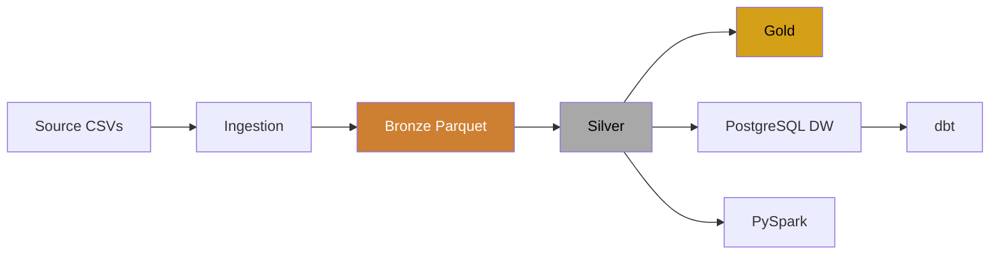
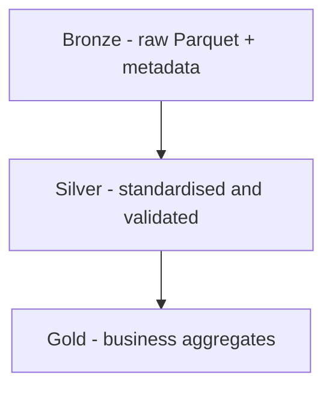

# Architecture

## Overview

The platform follows a Medallion (Bronze/Silver/Gold) architecture on top of a
PostgreSQL star-schema warehouse. Processing uses pandas for moderate datasets
and PySpark for distributed-style transformations.

## Components

- **Ingestion**: reads source CSVs, validates schemas, writes Bronze Parquet with
  metadata (hash, row count, timestamp).
- **Bronze**: raw preservation, one directory per table.
- **Silver**: standardised types, deduplication, referential validation.
- **Gold**: business aggregations.
- **Warehouse**: star schema loaded into PostgreSQL.
- **Spark**: PySpark analytics demonstrating distributed transformations.
- **dbt**: SQL transformations on top of the warehouse.
- **Orchestration**: Python pipeline + Airflow DAG reference.

## Data Flow

## Medallion Layers

- **Bronze**: raw source data preserved as Parquet with ingestion metadata and
  source hashes. No transformation beyond reading.
- **Silver**: standardised types, deduplicated keys, validated referential integrity.
- **Gold**: business-ready aggregations answering marketplace questions.

## Storage

- Raw/bronze/silver/gold: Parquet files on local filesystem (Data Lake concept).
- Warehouse: PostgreSQL.

## Idempotency

All ingestion and transformation steps overwrite their outputs deterministically,
making re-runs safe. Warehouse load truncates and reloads.

## Limitations

See [limitations.md](limitations.md). Warehouse load is not part of the main
pipeline; Spark has no committed entry point.
