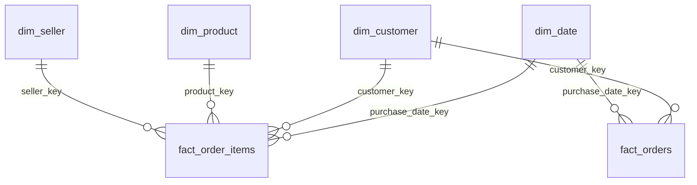

# Data Model

## Star schema

## Grain

- `fact_order_items`: one row per item within an order.
- `fact_orders`: one row per order.

## Surrogate keys

Dimensions use surrogate keys (SERIAL). Natural keys are preserved as unique columns
for traceability. Fact tables reference surrogate keys.

## Slowly Changing Dimensions

Not implemented (Type 1 overwrite). Justified: dimension attributes in this dataset
are static for the observed period.
